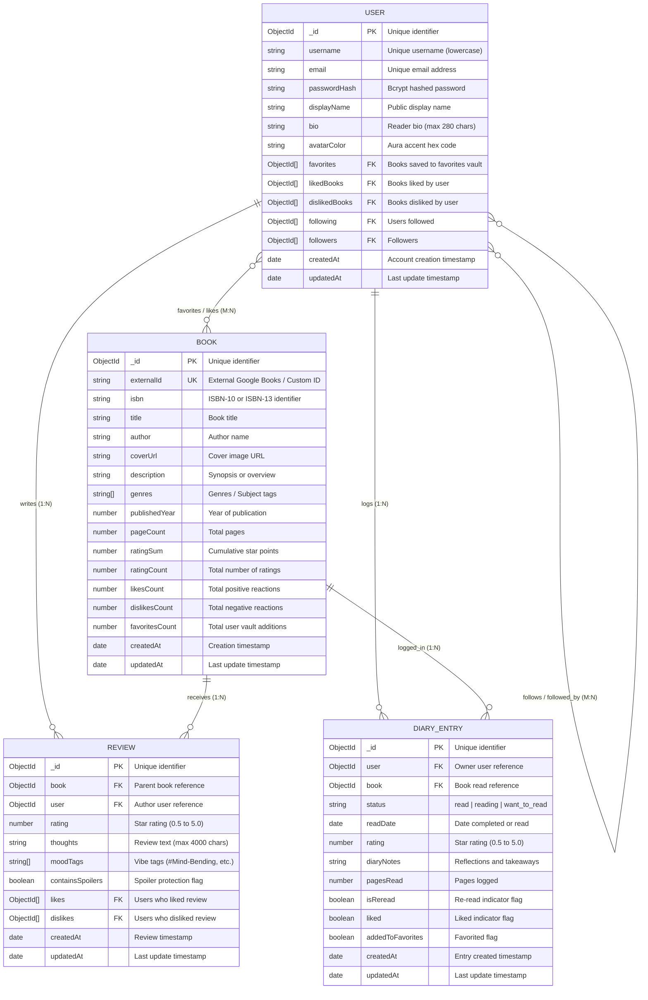

# 📚 AETHER // READS — Futuristic MERN Social Book Review & Reading Diary Platform

[](https://github.com/)
[](https://tailwindcss.com/)
[](https://developers.google.com/books)
[](https://opensource.org/licenses/MIT)

A full-stack, production-grade **MERN (MongoDB, Express.js, React 18, Node.js)** web application engineered for book discovery, community reviews, and reading diary tracking. The application features a responsive design with interactive 3D hardcover rendering, live MongoDB telemetry, Google Books API integration, JWT authentication, and **full CRUD capabilities** across all primary domain entities.

---

## 📑 Table of Contents
1. [Project Overview & Key Features](#-project-overview--key-features)
2. [Complete CRUD Operations Matrix](#-complete-crud-operations-matrix)
3. [System Architecture & Tech Stack](#-system-architecture--tech-stack)
4. [Entity-Relationship Diagram (ERD)](#-entity-relationship-diagram-erd)
5. [Modular Component Hierarchy](#-modular-component-hierarchy)
6. [API Specification (REST Endpoints)](#-api-specification-rest-endpoints)
7. [Step-by-Step Local Setup & Seeding](#-step-by-step-local-setup--seeding)
8. [Client & Server Validation & Security](#-client--server-validation--security)
9. [User Interface Screenshots](#-user-interface-screenshots)

---

## 🌟 Project Overview & Key Features

- **Tactile 3D Hardcover Book Experience**: Interactive 3D perspective rendering with physical drop shadows, realistic spine hinges, cream paper pages blocks, and dynamic geometric cover patterns.
- **Dual Book Sourcing (Local Catalog + External APIs)**: Integrated with the **Google Books API v1** and **Open Library API** with automated upsert synchronization into MongoDB.
- **5-Star Review Studio & Thoughts**: Full-featured review composer with half-star granularity, spoiler blur warnings, reading mood tags (`#Mind-Bending`, `#Atmospheric`, etc.), and community reaction counters.
- **Personal Reading Diary**: Letterboxd-style reading log to record completion dates, page progress, star ratings, notes, and re-read indicators.
- **Social Graph & Activity Stream**: Reader follow/unfollow system, interactive follower activity feed, and reader showcase.
- **Personal Vault & Shelves**: Filterable sanctuary organizing Favorites, Liked titles, Disliked titles, and Authored Reviews.
- **Live Database Telemetry**: Real-time MongoDB connection monitor displaying latency (ms), health status, uptime, and collection telemetry counters.

---

## ⚡ Complete CRUD Operations Matrix

The platform implements complete **Create, Read, Update, and Delete (CRUD)** operations with cascading relationships and data integrity enforcement:

| Entity | Create (C) | Read (R) | Update (U) | Delete (D) | Cascade & Validation Rules |
| :--- | :--- | :--- | :--- | :--- | :--- |
| **Book** | `POST /api/books`<br>Custom or API import | `GET /api/books`<br>`GET /api/books/:id` | `PUT /api/books/:id`<br>Protected by JWT | `DELETE /api/books/:id`<br>Protected by JWT | Deleting a book triggers **cascade deletion** of all related `Review` and `DiaryEntry` records. Validates title, author, and positive year/pages. |
| **Review** | `POST /api/reviews`<br>5-star rating + thoughts | `GET /api/reviews`<br>`GET /api/reviews/book/:id` | `PUT /api/reviews/:id`<br>Protected (Owner only) | `DELETE /api/reviews/:id`<br>Protected (Owner only) | Automatically recalculates parent `Book`'s `averageRating`, `ratingSum`, and `ratingCount`. Validates 0.5–5.0 star bounds and non-empty thoughts. |
| **Diary Entry** | `POST /api/diary`<br>Log book to diary | `GET /api/diary`<br>`GET /api/diary/user/:user` | `PUT /api/diary/:id`<br>Protected (Owner only) | `DELETE /api/diary/:id`<br>Protected (Owner only) | Allows editing date read, status (`read`, `reading`, `want_to_read`), rating, re-read status, and diary reflections with safe delete prompt. |
| **User Profile** | `POST /api/auth/register`<br>Bcrypt salted hash | `GET /api/users/:id`<br>`GET /api/auth/me` | `PUT /api/users/profile`<br>Protected (Owner only) | Session Logout / Token Eviction | Validates username (min 3 chars), email regex, password (min 6 chars), and bio max length (280 chars). |

---

## 🛠 System Architecture & Tech Stack

```
┌────────────────────────────────────────────────────────────────────────┐
│                        CLIENT LAYER (React 18 + Vite)                  │
│  - Modular Components (Navbar, BookCard, BookCover, Modals, StarRating) │
│  - Tailwind CSS + Lucide Icons + CSS 3D Transforms                     │
│  - REST API Client with JWT Bearer Interceptors & Local Storage Cache   │
└───────────────────────────────────┬────────────────────────────────────┘
                                    │ HTTP / JSON (REST)
                                    ▼
┌────────────────────────────────────────────────────────────────────────┐
│                        SERVER LAYER (Express.js + Node)                │
│  - Router Architecture: /api/auth, /api/books, /api/reviews, /diary    │
│  - JWT Bearer Authentication Middleware (`middleware/auth.js`)         │
│  - External Search Proxies (Google Books API v1 & Open Library API)    │
│  - Telemetry & Health Monitoring Engine (`/api/health`, `/api/stats`)  │
└───────────────────────────────────┬────────────────────────────────────┘
                                    │ Mongoose ODM
                                    ▼
┌────────────────────────────────────────────────────────────────────────┐
│                        DATABASE LAYER (MongoDB)                        │
│  - Collections: users, books, reviews, diaryentries                    │
│  - Virtuals: Book.averageRating, Cascade Hooks                         │
│  - Compound Indices on externalId, isbn, user, book                   │
└────────────────────────────────────────────────────────────────────────┘
```

- **Frontend**: React 18, Vite 5, Tailwind CSS 3, Lucide React icons.
- **Backend**: Node.js, Express 4, Mongoose 8, JSON Web Tokens (`jsonwebtoken`), `bcryptjs`, `cors`, `dotenv`.
- **Database**: MongoDB (Local instance or MongoDB Atlas).
- **External APIs**: Google Books REST API v1, Open Library Search API.

---

## 📊 Entity-Relationship Diagram (ERD)

The following Mermaid diagram depicts all entities, primary keys (`_id`), foreign key references (`ObjectId`), data types, and cardinalities:



---

## 🧩 Modular Component Hierarchy

Following clean code architecture and component reusability guidelines, the frontend is refactored into modular components located in `client/src/components/`:

```
client/src/
├── api/
│   └── client.js             # REST API methods (CRUD for books, reviews, diary, auth)
├── data/
│   └── initialData.js        # Fallback catalog & starter data
├── components/
│   ├── Navbar.jsx            # Top navigation bar, tab router & database telemetry badge
│   ├── StarRating.jsx        # Half/full star rating component (interactive & read-only)
│   ├── BookCover.jsx         # 3D interactive hardcover book with spine & paper edge
│   ├── BookCard.jsx          # Catalog book card with reaction buttons & quick review
│   ├── BookDetailModal.jsx   # Dossier modal with reviews, inline edit & delete actions
│   ├── AddEditBookModal.jsx  # Modal for indexing new books or editing existing dossiers
│   ├── LogBookModal.jsx      # Modal for logging new reading entries or updating logs
│   ├── AuthModal.jsx         # Authentication modal with login, register & demo switcher
│   ├── EditProfileModal.jsx  # User profile modal for updating bio, display name & avatar
│   └── HumanAvatar.jsx       # Illustrated SVG avatar with personalized aura gradients
├── App.jsx                   # Main orchestrator & state container
├── main.jsx                  # Application entry point
└── index.css                 # Tailwind directives & cyberpunk aesthetic styles
```

---

## 📡 API Specification (REST Endpoints)

### 🔐 Authentication & Users
- `POST /api/auth/register` — Register a new account (`username`, `email`, `password`, `displayName`, `bio`).
- `POST /api/auth/login` — Authenticate and receive a 7-day JWT bearer token (`emailOrUsername`, `password`).
- `GET /api/auth/me` — Retrieve the currently authenticated user's profile and shelves (requires JWT).
- `PUT /api/users/profile` — Update authenticated user's bio, display name, or avatar color (requires JWT).
- `GET /api/users` — Discover readers and their curated bookshelves.
- `GET /api/users/:identifier` — Fetch public reader profile by MongoDB `_id` or `username`.
- `POST /api/users/:id/follow` — Follow or unfollow a reader (requires JWT).
- `GET /api/users/feed/following` — Activity feed stream from followed readers (requires JWT).

### 📖 Books (Full CRUD)
- `GET /api/books` — Retrieve catalog books with optional query search (`?q=`), genre filter (`?genre=`), and sorting (`?sort=`).
- `GET /api/books/:id` — Retrieve a single book dossier by MongoDB `_id` or `externalId`.
- `POST /api/books` — Index a new custom book into MongoDB (requires JWT).
- `PUT /api/books/:id` — Update book metadata (`title`, `author`, `year`, `pages`, `genres`, `synopsis`, `cover`) (requires JWT).
- `DELETE /api/books/:id` — Delete book and **cascade-delete** all associated reviews and diary logs (requires JWT).
- `POST /api/books/import` — Upsert external book details into MongoDB (requires JWT).
- `POST /api/books/:id/react` — Toggle `favorite`, `like`, or `dislike` sentiment on a book (requires JWT).
- `GET /api/books/google-books` — Search external titles via Google Books API.
- `GET /api/books/external-search` — Search external titles via Open Library API.

### ⭐ Reviews (Full CRUD)
- `GET /api/reviews` — Fetch recent community reviews across all titles.
- `GET /api/reviews/book/:bookId` — Fetch all reviews for a specific book.
- `POST /api/reviews` — Submit a 5-star review with thoughts, mood tags, and spoiler flag (requires JWT).
- `PUT /api/reviews/:id` — Update an existing review's rating and thoughts (requires JWT, author only).
- `DELETE /api/reviews/:id` — Delete an authored review and recalculate book average rating (requires JWT, author only).
- `POST /api/reviews/:id/react` — Toggle like sentiment on a community review (requires JWT).

### 📔 Reading Diary (Full CRUD)
- `GET /api/diary` — Fetch recent public reading diary logs.
- `GET /api/diary/user/:username` — Fetch a specific reader's public reading diary.
- `POST /api/diary` — Log a book into the user's reading diary with date read and rating (requires JWT).
- `PUT /api/diary/:id` — Update an existing diary entry's status, date read, rating, notes, or re-read state (requires JWT, author only).
- `DELETE /api/diary/:id` — Remove an entry from the reading diary (requires JWT, author only).

### 📊 Telemetry & Health
- `GET /api/health` — Check server status, database connection, host, port, uptime, and environment.
- `GET /api/stats` — Live document count telemetry (`books`, `users`, `reviews`, `diaryEntries`).

---

## 🚀 Step-by-Step Local Setup & Seeding

### 1. Prerequisites
Ensure you have the following installed on your machine:
- **Node.js** (v18.0.0 or higher)
- **npm** (v9.0.0 or higher)
- **MongoDB Community Server** (running locally on port `27017` or a MongoDB Atlas URI)

### 2. Clone / Open Repository
```bash
cd "Book-Review-main"
```

### 3. Backend Setup
Navigate to the `server/` directory and install dependencies:
```bash
cd server
npm install
```

Create an `.env` file inside `server/` (or copy from `.env.example`):
```env
PORT=5000
MONGO_URI=mongodb://127.0.0.1:27017/aether_reads
JWT_SECRET=aether_reads_super_secure_jwt_secret_key_2026
GOOGLE_BOOKS_API_KEY=
NODE_ENV=development
```

Run the database seed script to populate books, demo readers, reviews, and diary logs:
```bash
npm run seed
```

Start the backend API server with nodemon (auto-reload):
```bash
npm run dev
```
The server will start at `http://localhost:5000`. You can verify health at `http://localhost:5000/api/health`.

### 4. Frontend Setup
In a new terminal window, navigate to the `client/` directory and install dependencies:
```bash
cd client
npm install
```

Start the Vite development server:
```bash
npm run dev
```
Open your browser and navigate to `http://localhost:5173`.

### 5. Production Build Test
To create an optimized production build of the React frontend:
```bash
cd client
npm run build
```
This builds static assets into `client/dist/`, which are automatically served by the Express backend in production mode.

---

## 🛡 Client & Server Validation & Security

- **JWT Authentication**: Secure Bearer tokens signed with HMAC SHA-256 and verified via Express middleware on all write operations.
- **Ownership Authorization**: `PUT` and `DELETE` operations for reviews and diary entries strictly verify `document.user.toString() === req.user.id.toString()`, returning `403 Forbidden` if unauthorized.
- **Cascading Integrity**: Deleting a book automatically removes all corresponding reviews and diary entries from MongoDB, preventing orphan documents.
- **Client & Server Input Validation**:
  - Empty or whitespace-only book titles, authors, and review thoughts are rejected with descriptive `400 Bad Request` messages.
  - Publication years must be valid positive integers (between 100 and 2100).
  - Page counts must be positive integers.
  - Star ratings are strictly validated within bounds `[0.5, 5.0]`.
  - Passwords must be at least 6 characters long; usernames must be at least 3 characters.
- **Safe Delete Protections**: All frontend deletion actions (Books, Reviews, Diary Logs) require explicit user confirmation via dialogs before issuing delete requests.

---

## 🖼 User Interface Screenshots

Drop your screenshots into the `./screenshots/` directory to display them below:

### 1. Catalog & 3D Hardcover Book Grid

*Discover catalog books with 3D perspective tilt, genre badges, ratings, and Google Books integration.*

### 2. Book Dossier Modal & Review Composer

*Detailed dossier with 3D cover, synopsis, reaction controls, Edit/Delete Book actions, and 5-Star review writer.*

### 3. Inline Review Editing & Community Feedback

*Inline editing of star ratings and review thoughts for authenticated review authors with spoiler toggle.*

### 4. Personal Reading Diary

*Reading diary showing completion dates, status badges, page progress, notes, and Edit/Delete controls.*

### 5. Reader Profile & Vault Shelves

*Curated bookshelves (Favorites, Liked, Disliked, Reviews) and profile editor for bio and avatar aura customization.*

### 6. MERN Architecture & Live Database Telemetry

*Live telemetry monitor pinging MongoDB and Express with real-time latency (ms) and document count telemetry.*

---

## 👥 Contributors & Academic Integrity
Developed as part of the Web Development MERN Stack Evaluation. All code adheres to university code quality, modular architecture, and academic integrity rubrics.
